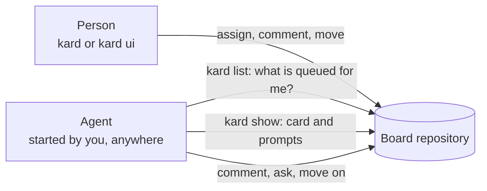
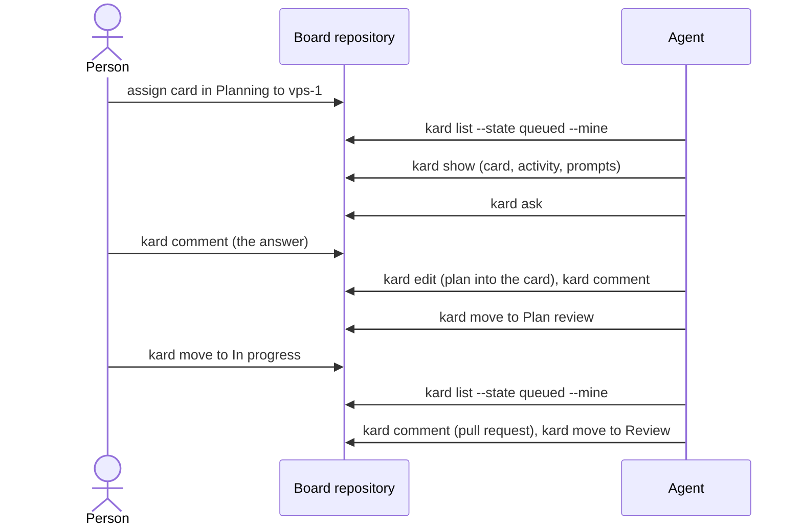

# Agents on a board: concept

**Status:** Draft v0, for discussion. Steps 1 and 2 of
[the order of building](#order-of-building) are built, the rest is not. It
describes how coding agents work cards on a board of today: Markdown files
in Git, no server, no database, no accounts.

The format and the commands of today are in [spec.md](spec.md). What a
server would add later is in [platform.md](platform.md).

## The idea in one picture



A person assigns a card to an agent. The agent looks at the board, reads
the card and what its column asks for, does the work, and moves the card
on or asks.

**kard is the board, not the foreman.** It starts no agent and watches
none. How an agent runs is yours to decide: Claude Code in a loop on a VPS,
a cron job, another tool, a script. All it needs is `kard` and the Git
access the machine has anyway.

**Nothing new to learn.** There are no runs and no claims. An agent works
with what the board already has: a card is assigned to it, lies in a
column, and is moved on when the work there is done. Only talking on a
card is added.

## What is added

| Part | What it is |
|---|---|
| `agents` and `agent` in `board.yaml` | which names are agents, and what each column asks of them |
| `activity/<card>.md` | what was said about a card, one file next to the columns |
| `kard comment`, `kard ask` | writing to the activity |
| the state of a card | `queued` or `waiting`, worked out from the files |
| `kard list --state`, `kard show --json` | an agent finds its cards and reads what to do |
| the page | shows state and activity, takes comments |

Agents on several machines need a board with `sync: push`. On one machine
every sync mode works.

## `board.yaml`

```yaml
agents: [vps-1, laptop]

agent:
  prompt: |
    This project is the customer portal. Read CLAUDE.md first.
    Never push to main.

columns:
  - id: planning
    title: Planning
    agent:
      next: plan_review
      prompt: |
        Cards here are not fully defined. Read the code the card is about
        and write a plan into the card: what changes, in which files, what
        is open. Change nothing in the project. Ask if something decides
        the approach.
  - id: plan_review
    title: Plan review
  - id: working_on
    title: In progress
    doing: true
    agent:
      next: review
      prompt: |
        Build what the card's plan says, on a branch of its own. Run the
        tests. Open a pull request and name it in a comment.
  - id: review
    title: Review
  - id: done
    title: Done
    done: true
```

| Key | Required | Meaning |
|---|---|---|
| `agents` | no | the names that are agents, written like any `person` |
| `agent.prompt` on the board | no | for every card an agent works: the project and its rules |
| `agent` on a column | no | agents work cards in this column |
| `agent.next` | yes, with `agent` | the column the agent moves the card to when it is done here |
| `agent.prompt` on a column | no | what a card in this column asks of the agent |

A column without `agent` belongs to people. A card of an agent waits there
until a person moves it.

**kard hands the prompts out and enforces nothing.** An agent reads them
with `kard show --json`. Whether they reach it as a system prompt or as a
message, and what the agent is allowed to do on its machine, is set where
the agent is started. So "change nothing in the project" is a sentence in
the prompt, not a mode of `kard`.

## Activity

What is said about a card is in `activity/<card>.md`, a file of its own in
a directory that is not a column:

```markdown
## 2026-11-27T14:15:09Z · vps-1 · question to arnold@example.com
Should the export keep the old CSV columns?

## 2026-11-27T14:31:40Z · arnold@example.com · comment
Yes, keep them.

## 2026-11-27T14:52:03Z · vps-1 · comment
The plan is in the card. Open: how large an export may get.
```

- **Entries are only added, never changed**, and only by `kard`. Each one
  is a commit of its own: `comment export-as-pdf`, `ask export-as-pdf`.
- **The card's file stays untouched by them.** A person editing the text
  and an agent reporting at the same moment do not get in each other's way.
- **Nothing gets lost.** If two write to the same activity at the same
  moment, the second entry is added again below the first.
- **The head** is `## <time> · <person> · <kind>`, the time in UTC to the
  second. What follows is free Markdown. A line of it that would read as a
  head is written with a backslash in front.
- **Kinds:** `comment` and `question`.
- **A question may be for someone:** `question to <person>, <person>`.
  `kard ask --to` looks names up as `kard assign` does and writes the full
  address, so the file always says exactly who is meant. Without `--to` the
  question is for whoever sees it.
- **Anyone may comment on any card.** A comment changes nothing about the
  card, so it needs no `--force`.
- **The file follows the card.** `kard rename` renames it too. `kard lint`
  reports an activity file without a card (E12) and one that breaks this
  format (E13). `activity` cannot be the name of a column.

## The state of a card

Nothing stores a state. It follows from the files, so everyone who reads
the board sees the same. The first row that fits applies:

| State | When |
|---|---|
| `waiting` | an agent asked a question, and no person has written since |
| `queued` | the card belongs to an agent, its column has `agent`, and every card under `depends_on` is done |
| none | anything else |

`queued` says: it is the agent's turn.

- **A person** is anyone who is not under `agents`.
- **Any person's entry ends the waiting**, not only one by those the
  question was for. `--to` says whom it concerns, not who may answer.
- **`waiting_for`** goes with `waiting` when the question named someone.
  Nobody is guessed: without `--to` the card just waits.
- **A card on another board** under `depends_on` does not hold a card
  back; one that does not exist does.

`kard list --json` and `kard show --json` carry `state` and `waiting_for`.
`kard list --state queued` lists only the cards in that state.

## A card's way through



**An agent's work in a column ends in one of two ways: it moves the card
on, or it asks.**

- **Moving on** is `kard move <card> <next>`. The card leaves the agent's
  column, or arrives in the next one that has `agent`.
- **Asking** is `kard ask`. The card waits until a person writes, and is
  then the agent's again, with the answer in its activity.
- **A card the agent leaves where it is stays `queued`.** The agent finds
  it again the next time it looks, together with what it wrote itself.
  That is why every agent's column names a `next`.
- **Taking back.** A person who wants a card back unassigns the agent or
  moves the card to a column of people. There is nothing to stop.

## What an agent does

```bash
export KARDBOARD_USER=vps-1 KARD_BOARD=~/Repos/portal-board

kard list --state queued --mine --json     # what is my turn?
kard show export-as-pdf --json             # card, activity, prompts, next

export KARD_CARD=export-as-pdf
kard comment "The plan is in the card."
kard move export-as-pdf plan_review        # done here
```

| Step | Command | What it gives or does |
|---|---|---|
| Look | `kard list --state queued --mine` | the cards whose turn is the agent's |
| Read | `kard show <card> --json` | title, fields, text, the activity, and under `agent` the board's `prompt`, the column's `column_prompt` and `next` |
| Report | `kard comment`, `kard edit` | what people should know, and the plan into the card |
| Ask | `kard ask [--to person]` | for what decides the approach; then the agent leaves the card alone |
| End | `kard move <card> <next>` | the work in this column is done |

**Names come from the environment.** `KARDBOARD_USER` says which agent
this is and `KARD_BOARD` names the board directory, as `-C` does.
`KARD_CARD` names the card for `kard comment` and `kard ask`.

**Who takes what.** A person assigns a card to an agent by name, so one
name stands for one agent. Two processes under the same name would both
find the same card. Where several agents share a pile of cards that are
nobody's, `kard take` is the claim: it assigns and moves in one commit,
and Git lets only one push through.

What is left to whoever starts the agent: looking at the board in
intervals, a fresh session per card, a Git worktree per card in the
project, and what a session costs.

## New commands

| Command | Effect |
|---|---|
| `kard comment [card] [text] [--text file]` | adds a comment, with `-` from stdin |
| `kard ask [card] [question] [--to person] [--text file]` | asks a question, for someone or for whoever sees it |
| `kard list --state <state>` | only the cards that are `queued` or `waiting` |

`kard show` shows the activity below the card, and with `--json` what the
card's column asks of an agent. `kard log` stays what it is: the commits.

## The page

The look and its rules stay as they are.

| Where | What |
|---|---|
| Card in the column | the state as one mark |
| `waiting` | the highlighter: by the look's own rule it marks the one thing to look at |
| Card panel | Activity below the text, with a field to comment |
| Monogram | agents are told apart from people at a glance |
| Top bar | "Waiting for me": the cards whose question names you, next to "Only mine" |

There is no chat. Whoever wants to talk to an agent's session directly
opens it on the agent's machine.

## Order of building

| Step | What | Done when |
|---|---|---|
| 1 | `agents` and `agent` in `board.yaml`, the activity file, `kard comment` and `kard ask`, the state in `--json`, lint | a person and a script can hold a conversation on a card. **Built** |
| 2 | `kard list --state`, the prompts in `kard show --json` | a script that plays an agent finds its card, reads what to do and moves it on. **Built** |
| 3 | the page: state, activity, comment | all of it works without a terminal |
| 4 | the kard skill, spec.md, and an example of an agent's loop under `examples/` | an agent that has never seen a board reports correctly |

Each step is a change of its own that can be merged alone.

## What this does not do

| Limit | What it means |
|---|---|
| kard starts nothing | no agent runs because a card is queued. Something of yours has to look at the board |
| No mark for "being worked on" | a queued card does not say whether the agent has it yet. An agent that comments when it starts says so |
| No guard against repeating | an agent that neither moves its card on nor asks finds it again |
| No cost | what a session used is counted where the agent runs, not on the board |
| Prompts are not enforced | what an agent may do is set where it is started, not in `board.yaml` |
| No page from outside | `kard ui` needs a clone on the machine. On a phone there is only the repository |
| Seconds of delay | an agent sees a card when it looks next |
| Few writers | one person and a few agents push without trouble; a large team with many agents would retry often |

When one of these hurts, [platform.md](platform.md) is the next step.
platform.md still describes a runner of its own, runs and their cost;
where it differs from this document, this one applies.

## Open decisions

| Question | Proposal |
|---|---|
| May agents assign cards to agents? | Not at first. Agents create cards, a person assigns them |
| Does a pull request belong in a field of the card? | Not yet. A comment names it; a field comes when the page should link it |
| Should `kard show` print the prompts without `--json` too? | Not at first. They are for agents, and agents read JSON |

Decided:

| Question | Decision |
|---|---|
| Activity in a file of its own or as a section of the card? | A file of its own. Otherwise every report changes the card while someone edits its text |
| A runner in `kard`? | No. kard is the board agents and people work through; agents are started by whoever runs them |
| Runs, with entries for start and end? | No. The column is the state: an agent takes a card that is assigned to it and moves it on. With the runs go their cost, `kard stop` and `kard retry` |
| Who is a question for? | Whom `--to` names, else whoever sees it. Nobody is guessed |
| `mode` and `max_turns` in `board.yaml`? | No. kard cannot enforce either; the prompt says what a column allows |
