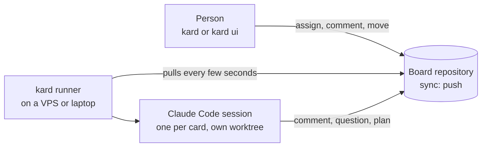
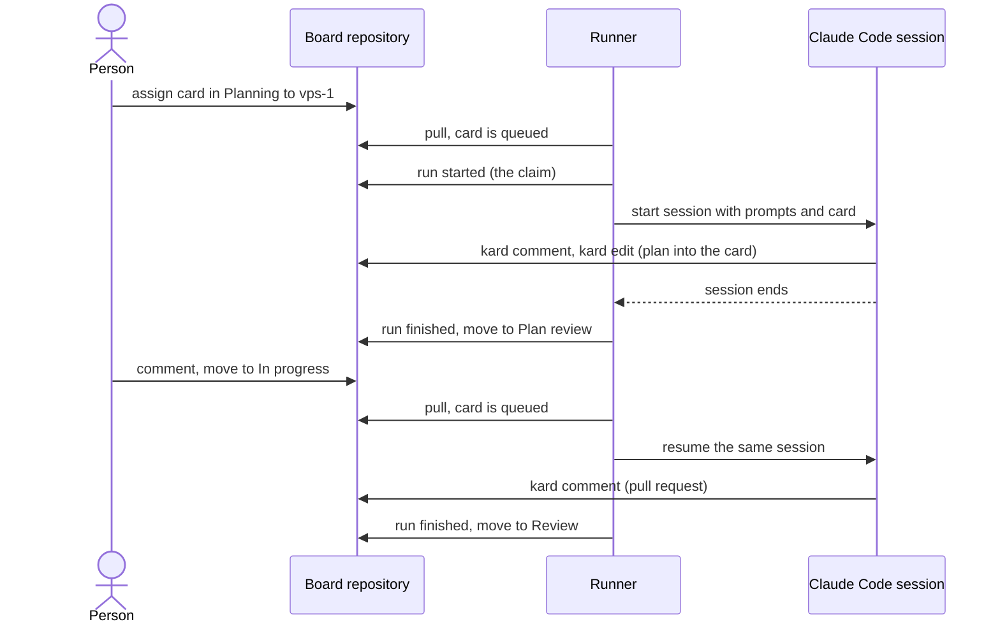

# Agents on a board: concept

**Status:** Draft v0, for discussion. Nothing here is built. It describes
how coding agents work cards on a board of today: Markdown files in Git,
no server, no database, no accounts.

The format and the commands of today are in [spec.md](spec.md). What a
server would add later is in [platform.md](platform.md).

## The idea in one picture



A person assigns a card to an agent. The runner on the agent's machine
sees the commit, starts a fresh coding session with the card and the
prompt of its column, and what the session reports comes back as commits.

**Why this is enough to start.** The board repository is already the
shared state, `git push` already decides who was first, and `git log` is
already the record. The machine needs the Git access it has anyway. No
further credentials, no sign-in to build.

## What is added

| Part | What it is |
|---|---|
| `agents` and `agent` in `board.yaml` | which names are agents, and what each column asks of them |
| `activity/<card>.md` | comments, questions and runs of a card, one file next to the columns |
| `kard comment`, `kard ask`, `kard stop`, `kard retry`, `kard cost` | writing and reading the activity |
| `kard runner` | waits for cards and runs the sessions |
| the page | shows state, activity and cost, takes comments |

Agents need a board with `sync: push`. On other boards the runner refuses
and says why.

## `board.yaml`

```yaml
agents: [vps-1, laptop]

agent:
  max_turns: 80
  prompt: |
    This project is the customer portal. Read CLAUDE.md first.
    Never push to main.

columns:
  - id: planning
    title: Planning
    agent:
      mode: plan
      next: plan_review
      prompt: |
        Cards here are not fully defined. Read the code the card is about
        and write a plan into the card: what changes, in which files, what
        is open. Ask if something decides the approach.
  - id: plan_review
    title: Plan review
  - id: working_on
    title: In progress
    doing: true
    agent:
      mode: build
      next: review
      prompt: |
        Build what the card's plan says, on the card's branch. Run the
        tests. Open a pull request and name it in a comment.
  - id: review
    title: Review
  - id: done
    title: Done
    done: true
```

| Key | Meaning |
|---|---|
| `agents` | the names that are agents, written like any `person`. A card assigned to one of them can be run |
| `agent.prompt` on the board | applies to every run: the project and its rules |
| `agent.max_turns` | where a run ends at the latest |
| `agent.prompt` on a column | what a card in this column asks of the agent |
| `agent.mode` | `plan`: the session reads the project and writes to the card, nothing else. `build`: it changes the project |
| `agent.next` | the column the card goes to when the run is finished |

A column without `agent` belongs to people. A card of an agent waits there
until a person moves it.

## Activity

Everything said about a card and every run on it is in
`activity/<card>.md`, a file of its own in a directory that is not a
column:

```markdown
## 2026-11-27T14:02Z · vps-1 · run started
column: planning
session: 5f3c2a9e-41d7

## 2026-11-27T14:15Z · vps-1 · question
Should the export keep the old CSV columns?

## 2026-11-27T14:15Z · vps-1 · run paused
column: planning
duration: 13m
turns: 31
tokens: 812400 in, 9100 out
cost: 1.12 USD

## 2026-11-27T14:31Z · arnold · comment
Yes, keep them.
```

- **Entries are only added, never changed**, and only by `kard`. Each one
  is a commit of its own: `comment export-as-pdf`,
  `run export-as-pdf: started in planning`.
- **The card's file stays untouched by them.** A person editing the text
  and an agent reporting at the same moment do not get in each other's way.
- **Kinds:** `comment`, `question`, `retry`, `stop`, and for runs
  `run started`, `run paused` (a question is open), `run finished`,
  `run failed`.
- **The file follows the card.** `kard rename` renames it too. `kard lint`
  reports an activity file without a card. `activity` cannot be the name of
  a column.

### The state of a card

Nothing stores a state. It follows from the files, so everyone who reads
the board sees the same:

| State | When |
|---|---|
| `running` | the last run entry is `run started` |
| `waiting for you` | the last run entry is `run paused` and no person has written since |
| `failed` | the last run entry is `run failed` and no person has written since |
| `queued` | the card belongs to an agent, its column has `agent`, every card under `depends_on` is done, it is not running, and one of these holds: there is no run yet, a person has written since the last run, or the last run was in another column |
| none | anything else |

So a run starts by assigning, by moving into an agent's column, or by a
person's comment. `kard list --json` and `kard show --json` carry the
state.

## A card's way through



- **The claim is the `run started` entry.** If two pushes meet, Git takes
  one, and the other runner leaves the card alone.
- **The runner moves the card, not the session.** A finished run goes to
  `next`. A run with an open question stays where it is.
- **A comment during a run is not lost.** When the session ends, the
  runner looks for what people wrote since the start and hands it to the
  same session before it closes the run.
- **Stopping.** `kard stop <card>` writes an entry; the runner sees it at
  its next pull, ends the session and closes the run as failed, with who
  stopped it.
- **A runner that died** closes its open runs as failed when it starts
  again. `kard retry <card>` queues the card.

## The runner

`kard runner` is part of the same `kard` file.

```yaml
# ~/.config/kardboard/runner.yaml
agent: vps-1
every: 20s
boards:
  portal:
    project: ~/Repos/portal
```

| Step | What happens |
|---|---|
| Look | pulls the board, as `kard sync` does, and takes the oldest queued card of its agent |
| Claim | writes `run started` and pushes |
| Prepare | a Git worktree of the project for the card, on a branch `kard/<card>` |
| Start | a fresh Claude Code session in that worktree, or the card's earlier session if this machine has it |
| Follow | pulls the board in intervals and watches for `stop` |
| Finish | writes the run's end with its numbers, moves the card, pushes |

- **One card at a time.** Several sessions on one machine share its
  database and its ports.
- **One agent name, one runner.** Two machines are two agents.
- **A fresh session per card.** A card starts with an empty context, and
  the session can be resumed because its id is in the run entry.
- **The subscription login of the machine applies.** The runner starts the
  ordinary `claude` command. With `ANTHROPIC_API_KEY` set, the API is used
  instead.
- **`kard runner --once`** works one card and exits, for trying out.

The calls, checked against the Claude Code documentation:

```bash
# first run on a card
claude -p "$CARD" --append-system-prompt-file "$RUN/prompt.md" \
  --output-format json --max-turns 80

# every further run on the same card
claude -p "$NEW_ENTRIES" --resume "$SESSION" --output-format json
```

**What a session is given**, in this order: the board's prompt, the
column's prompt, the card (title, fields, text), its activity so far, and
how to report: `kard comment` for what people should know, `kard ask` and
then stop for what decides the approach, `kard edit` for the plan.

The runner sets `KARDBOARD_USER`, `KARD_BOARD` and `KARD_CARD` for the
session, so its `kard` calls need no names.

## Tokens and cost

Claude Code reports at the end of every run what it used. The runner
writes these numbers into the run's entry:

| In the entry | From the session's result |
|---|---|
| `duration` | measured by the runner |
| `turns` | `num_turns` |
| `tokens` | `usage`: input including cached, and output |
| `cost` | `total_cost_usd` |

- **`cost` is the price at API rates.** Under a subscription nothing is
  charged per run; the number says what the run would have cost, and how
  one card compares to another.
- **Per card:** `kard show` and the page sum the runs of a card.
- **Quiet on the page.** The numbers are there to be looked up, not to be
  read along. A run's line says when it ran and how long. Its tokens,
  turns and cost open from an info mark at the end of the line. The card's
  total stands once, small, at the head of the activity.
- **Per board:** `kard cost [--since date]` lists cards, runs, tokens and
  cost, with a total. `--json` as everywhere.

## New commands

| Command | Effect |
|---|---|
| `kard comment <card> [--text file]` | adds a comment, with `-` from stdin |
| `kard ask <card> "<question>"` | asks the people on the card |
| `kard stop <card>` | ends the run that is open |
| `kard retry <card>` | queues the card again |
| `kard cost [--since date]` | what the runs on the board used |
| `kard runner [--once]` | runs the runner |

`kard show` shows the activity below the card. `kard log` stays what it
is: the commits.

## The page

The look and its rules stay as they are.

| Where | What |
|---|---|
| Card in the column | the state as one mark |
| `waiting for you` | the highlighter: by the look's own rule it marks the one thing to look at |
| Card panel | Activity below the text, with a field to comment |
| Card panel | Stop while a run is open, Retry after a failure |
| Head of the activity | the card's total in one small line: runs, time, cost |
| Line of a run | an info mark that opens the run's tokens, turns and cost |
| Monogram | agents are told apart from people at a glance |
| Top bar | "Waiting for me", next to "Only mine" |

There is no chat. Whoever wants to talk to a session directly opens it in
Claude Code on the runner's machine with `claude --resume <id>`; the id is
in the run's entry.

## Order of building

| Step | What | Done when |
|---|---|---|
| 1 | `agents` and `agent` in `board.yaml`, the activity file, `kard comment` and `kard ask`, the state in `--json`, lint | a person and a script can hold a conversation on a card |
| 2 | `kard runner`, `kard stop`, `kard retry`, the numbers in the run entry, `kard cost` | a card assigned to an agent comes back planned, and after approval built |
| 3 | the page: state, activity, comment, cost | all of it works without a terminal |
| 4 | the kard skill and spec.md | an agent that has never seen a board reports correctly |

Each step is a change of its own that can be merged alone.

## What this does not do

| Limit | What it means |
|---|---|
| No page from outside | `kard ui` needs a clone on the machine. On a phone there is only the repository |
| Seconds of delay | an agent starts at its runner's next pull |
| Milestones, no live status | every report is a commit, so there is no line that changes every few seconds |
| Few writers | one person and a few agents push without trouble; a large team with many agents would retry often |

When one of these hurts, [platform.md](platform.md) is the next step.
Prompts, runner and commands stay the same; only pulling is replaced by a
server.

## Open decisions

| Question | Proposal |
|---|---|
| Activity in a file of its own or as a section of the card? | A file of its own. Otherwise every report changes the card while someone edits its text |
| What may a `build` session do without asking? | On a VPS that exists only for this: everything. On a laptop: a list of allowed commands per board |
| How is `plan` held to reading? | To be tried in step 2: Claude Code's plan mode may also refuse the `kard` calls the session needs. If so, a list of allowed tools instead |
| May agents assign cards to agents? | Not at first. Agents create cards, a person assigns them |
| Does a pull request belong in a field of the card? | Not yet. A comment names it; a field comes when the page should link it |
