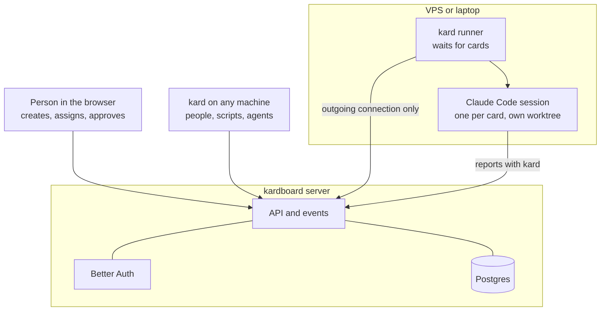
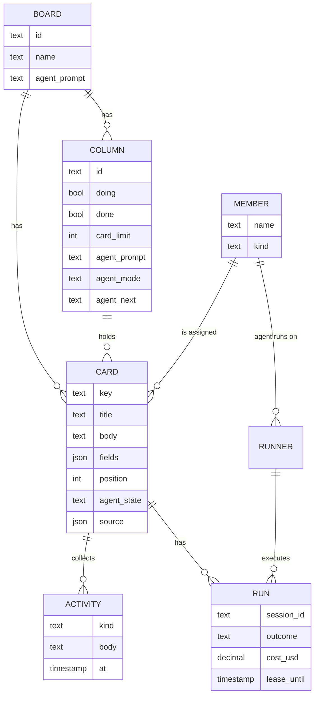
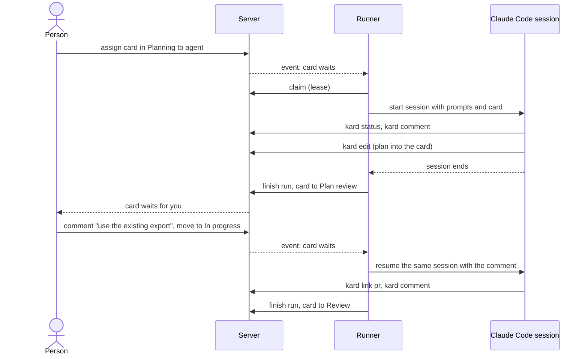

# kardboard platform: concept

**Status:** Draft v0, for discussion. Nothing here is built. It describes a
second way to run kardboard: one server that holds the boards, with people
in the browser and coding agents on their own machines working the same
cards.

**This is the later step.** Agents come first on the board of today, in
Git and without a server: see [agents.md](agents.md). This document is what
follows if that reaches its limits, above all a page that is reachable
from anywhere. Column prompts, the runner and the commands are the same in
both; where the two documents differ in a detail, agents.md is the newer
one.

The file format and the `kard` command of today are in
[spec.md](spec.md) and stay as they are.

## The idea in one picture



A person assigns a card to an agent. The runner on the agent's machine
hears of it, starts a fresh coding session with the card and the prompt of
its column, and the session reports back to the card. The person reads the
result on the card and approves, corrects or stops.

## What stays, what changes

| | Today (files) | Platform (server) |
|---|---|---|
| Where a board lives | a directory with `board.yaml` | a row in Postgres |
| Who sees a change | whoever pulls the repository | everyone, at once |
| History | `git log` | an event log in the database |
| Who you are | Git address or settings | an account: a person or an agent |
| How an agent hears of work | it is told, or it looks | the server tells its runner |
| Changing a card | `kard` or an editor | `kard` or the web page |
| Reading without kardboard | any editor, `grep` | `kard export` writes the files |
| The look | ink on paper | the same |

**Both stay.** The file board is a product of its own for one person or a
small team with a repository. The platform is for a team that hands work to
agents. `kard` speaks to either: a directory as today, or a server after
`kard login`.

**Postgres only.** No SQLite, no choice of store. Claims, events and
accounts need a server anyway, and every further store triples the work for
each feature.

## Principles

1. **The card is the agent's desk.** What the agent needs is on the card,
   and what it did comes back to the card. There is no chat window.
2. **An agent is a member like a person.** It has a name, a monogram, and
   cards are assigned to it the same way.
3. **Agents use `kard`, people use the page.** The page does nothing the
   command cannot do. This rule is kept from today.
4. **The column says what to do.** A card in Planning is to be planned, a
   card in the working column is to be built. Each column carries its own
   prompt.
5. **A person stands between plan and build.** An agent finishes a step
   and hands the card back. The next step starts when a person moves it on.
6. **Runners call out, nobody calls in.** A runner needs no open port and
   no fixed address. A laptop behind a router works like a VPS.
7. **No lock-in.** A server board exports to the file format and a file
   board imports into the server.

## What carries over from the format

The model is today's, stored in tables instead of files.

| Today | Platform |
|---|---|
| `board.yaml`: `id`, `name`, `columns`, `fields` | the same keys, edited in the page or with `kard` |
| column with `doing`, `done`, `limit` | the same, plus `agent` (see [Column prompts](#column-prompts)) |
| card key = file name, unique in the board | the same short name, still written `board/card` |
| header fields and their types | the same, checked by the same rules |
| title and Markdown text | the same |
| `assignee` of type `person` | a member: a person or an agent |
| rules: required fields, limits, other people's cards need `--force` | the same, checked on the server |

New on a card:

| What | Why |
|---|---|
| **Position in the column** | the directory had no order; the database has one |
| **Activity** | comments, questions, status lines and what the server recorded |
| **Runs** | every agent session on this card: runner, start, end, outcome, cost, session id |
| **State of the agent** | `queued`, `running`, `waiting for you`, `failed`, or none |
| **Links** | branch, pull request, preview, each with a kind |
| **Source** | where the card came from (system, id, link back), unique per board |

`source` is what lets another tool hand over tasks without creating them
twice. kardboard itself knows nothing about those tools.



## Column prompts

A column that agents work in carries `agent`. In an exported `board.yaml`
it looks like this:

```yaml
agent:
  prompt: |
    This project is the customer portal. Read CLAUDE.md first.
    Never push to main.

columns:
  - id: planning
    title: Planning
    agent:
      mode: plan
      next: plan_review
      prompt: |
        Cards here are not fully defined. Read the code the card is about
        and write a plan into the card: what changes, in which files, what
        is open. Ask on the card if something decides the approach.
  - id: plan_review
    title: Plan review
  - id: working_on
    title: In progress
    doing: true
    agent:
      mode: build
      next: review
      prompt: |
        Build what the card's plan says, on a branch of its own. Run the
        tests. Open a pull request and link it on the card.
  - id: review
    title: Review
  - id: done
    title: Done
    done: true
```

| Key | Meaning |
|---|---|
| `prompt` on the board | applies to every run: the project, its rules |
| `prompt` on a column | what a card in this column asks of the agent |
| `mode` | `plan`: the session may read but not change the project. `build`: it may change it |
| `next` | the column the card goes to when the agent is finished. The card stays assigned to the agent and is marked as waiting for a person |

A column without `agent` belongs to people. An agent's card there waits.

**What a session is given**, in this order: the board's prompt, the
column's prompt, the card (title, fields, text), the card's activity so
far, and how to report back with `kard`.

## A card's way through



**A run starts** when all of this holds: the card is assigned to an agent,
it is in a column with `agent`, every card under `depends_on` is done, and
no run is open on it. That becomes true by assigning, by moving, or by a
person's comment on a card whose agent is waiting.

**Claiming is exclusive.** The server gives a card to one runner, in one
statement. The run holds a lease that the runner renews every few seconds.
If the runner disappears, the lease runs out, the card says so and goes
back to `queued`.

**Finishing.** When the session ends without an open question, the runner
closes the run and the server moves the card to `next`. If the session
fails or runs into its limit, the card stays where it is and shows
`failed` with the reason.

## The runner

`kard runner` is part of the same `kard` file. It runs on the machine
where the agent works: a VPS that is always on, or a laptop while it is
open.

```yaml
# ~/.config/kardboard/runner.yaml
server: https://kardboard.example.com
agent: vps-1
slots: 1
projects:
  portal: ~/Repos/portal
harness: claude
```

| Step | What happens |
|---|---|
| Connect | one outgoing connection to the server's event stream; if it drops, the runner asks again in intervals |
| Claim | takes the oldest waiting card of its agent, as far as a slot is free |
| Prepare | a Git worktree for the card on a branch `kard/<card>`, in the project that belongs to the card's board |
| Start | a fresh Claude Code session in that worktree |
| Follow | reads the session's output, renews the lease, passes on the last status line |
| Finish | reports outcome, cost and session id; keeps the worktree until the card is done |

**A fresh session per card**, never one long session that is cleared in
between. A card then starts with an empty context, two cards cannot mix,
and the card's session can be resumed later because its id is on the run.

The calls, checked against the Claude Code documentation:

```bash
# first run on a card
claude -p "$CARD_PROMPT" \
  --append-system-prompt-file "$RUN_DIR/prompt.md" \
  --output-format stream-json --verbose \
  --permission-mode plan \
  --max-turns 80

# every further run on the same card
claude -p "$NEW_COMMENTS" --resume "$SESSION_ID" \
  --output-format stream-json --verbose
```

- **Not `--bare`.** Bare mode does not read the subscription login and
  needs an API key. The runner starts the ordinary command, so the machine's
  own login applies. Setting `ANTHROPIC_API_KEY` switches to the API.
- **`mode` becomes the permission mode.** `plan` starts the session in plan
  mode. `build` needs a decision, see [Open decisions](#open-decisions).
- **Limits per run.** `--max-turns` and `--max-budget-usd` come from the
  board, so a run that goes in circles ends.
- **One slot to start with.** Several sessions on one machine share its
  database and its ports. More slots come once each worktree gets its own
  copy of the database.
- **Other harnesses later.** The runner starts a command and reads its
  output. Claude Code is the first one, nothing in the server depends on it.

## What the agent does in its session

The session uses `kard` like a person at a terminal. The
[kard skill](../skills/kard/SKILL.md) already teaches the commands of today.
The runner sets `KARD_CARD` and `KARD_RUN`, so the commands need no card
name.

New commands:

| Command | Effect |
|---|---|
| `kard login <url>` | signs this machine in to a server, see [Accounts](#accounts) |
| `kard comment [card] [--text file]` | adds a comment to the card |
| `kard status [card] "<line>"` | sets the one line the card shows while the agent works |
| `kard ask [card] "<question>"` | asks the people on the card and marks it `waiting for you` |
| `kard link [card] <kind> <url>` | attaches a branch, pull request or preview |
| `kard stop <card>` | ends the open run |
| `kard retry <card>` | queues the card again after a failure |
| `kard runner` | runs the runner |
| `kard export <dir>`, `kard import <dir>` | writes a server board as files, reads a file board into the server |

The commands of today (`list`, `show`, `new`, `move`, `take`, `done`,
`assign`, `set`, `edit`, `log`) work against the server unchanged, with the
same output and the same exit codes.

**An agent may change its own cards and create new ones.** The rule of
today carries over: a card that belongs to someone else needs `--force`,
and agents do not get `--force`.

## Session history and steering

The question: should the card show the session's chat, and should a person
be able to steer the agent from there?

**No chat on the card.** A chat window turns kardboard into a second agent
harness, and the point of the platform is that work runs without someone
watching. What a person needs comes in three levels:

| Level | What it is | When |
|---|---|---|
| **Activity** | what the agent chooses to report: a status line while it works, comments, questions, the result; plus what the server records (started, finished, failed, cost) | from the start |
| **Steering through the card** | a comment, an answer, Stop, Retry | from the start |
| **Transcript** | the session's full log, read-only and folded away, to look up why it did something | later, per board |

Steering works without a chat because every run resumes the card's
session:

| A person does | The agent gets |
|---|---|
| answers a question | the answer as the next message; the session goes on |
| comments on a finished step | the comment as the next message, in the same session with everything it already knows |
| moves the card to the next agent column | that column's prompt, in the same session |
| presses Stop | the run ends, the card keeps what was reported |

A comment written while the agent is working waits until its current run
ends. Delivering it into the running session is possible later; Claude
Code can take messages while it runs, but the format is not documented
well enough to build on yet.

**Whoever wants to talk to the session directly** uses Claude Code itself.
The run shows its session id and the command to open it on the runner's
machine: `claude --resume <id>`.

**Why the transcript is not first.** The runner reads the session's output
anyway, so storing it is little work. But tool output can hold secrets
from the machine, and a log of every step is long. It is for looking
things up, so it is a switch per board and comes after the rest works.

## Accounts

| Who | Signs in with | Holds |
|---|---|---|
| Person in the browser | Better Auth, as in the other apps | a session |
| Person with `kard` | `kard login`: the command shows a code, the person confirms it in the browser (device authorization) | a token in `~/.config/kardboard/` |
| Agent and its runner | an API key, created by a person in the page | `KARD_TOKEN` on the machine |

An agent is an account of the kind `agent`, created by a person, without a
password. Its API key is its only way in and can be withdrawn in the page.
Both ways exist in Better Auth as plugins (device authorization, API keys
with permissions).

One server is one team. Organizations inside a server are left out until
someone needs them.

## The page

The look and its rules stay; they are written down at the top of
[app.css](../internal/server/web/app.css). The page is rebuilt in the
server's stack with the same tokens, type and grid.

What is added:

| Where | What |
|---|---|
| Card in the column | the agent's state as one mark, and the status line while it runs |
| `waiting for you` | the highlighter: by the look's own rule it marks the one thing to look at |
| Card panel | Activity (comments, questions, events) and Runs, below the text |
| Card panel | a field to comment; Stop and Retry while they apply |
| Monogram | agents are told apart from people at a glance |
| Top bar | "Waiting for me", next to "Only mine" |
| Board settings | columns with their prompts, members, agents and their keys |
| Menu | the runners: which are connected, what each is working on |

## Hosting

- **Reachable from outside, over HTTPS.** Runners on a VPS and people on
  the road reach the same address.
- **One app and one Postgres**, deployed like the other internal apps.
- **Nothing reaches into a runner.** The server never opens a connection
  to a machine, and holds no key to one.

## Stages

| Stage | What is built | Done when |
|---|---|---|
| **0 Agents in Git** | everything in [agents.md](agents.md): column prompts, activity, `kard runner`, cost, on a board of today | cards assigned to an agent come back planned and built, and the limits of Git are known from use |
| **1 Server** | app, accounts, boards and cards in Postgres, the page as today, `kard login` and today's commands against the server | a team works a board in the browser and with `kard`, without agents |
| **2 Agents** | agent accounts, column prompts, `kard runner`, runs, activity, steering by comment, Stop and Retry | a card assigned to an agent comes back planned, and after approval built |
| **3 Comfort** | transcript, several slots, export and import, source for cards from other tools, notifications | as needed |

Stage 0 needs no server. It answers the question everything else rests on:
whether a column prompt and a card are enough for an agent to do good work
alone. It may also turn out to be all that is needed.

## Open decisions

| Question | Proposal |
|---|---|
| Same repository or a new one? | The same: `kard` and the server share the card model and one API. The app goes in `server/` |
| Does `kard` stay in Go? | Yes. One file without dependencies is what makes it easy to put on a VPS |
| What may a `build` session do without asking? | On a VPS that exists only for this: everything. On a laptop: a list of allowed commands per board |
| Does build start by itself after an approved plan? | Yes, by moving the card. Moving is the approval |
| May agents assign cards to agents? | Not at first. Agents create cards; a person assigns them |
| Does the page follow changes live? | Yes, over one event stream, as today's page does |
| One subscription for several people's agents? | Each agent runs under its owner's login, or under an API key |

## Risks

- **Billing can change.** Today a session started with the subscription
  login counts against the subscription's limits, also without someone at
  the keyboard. Anthropic paused a change to this in June 2026 and says
  "for now". The runner therefore takes either the login or an API key.
- **An agent that runs alone can run in the wrong direction.** The person
  between plan and build, and limits per run, are what keeps that cheap.
- **Secrets in what agents report.** Comments and transcripts are written
  by a program that reads the machine. Transcripts are off unless a board
  turns them on.
